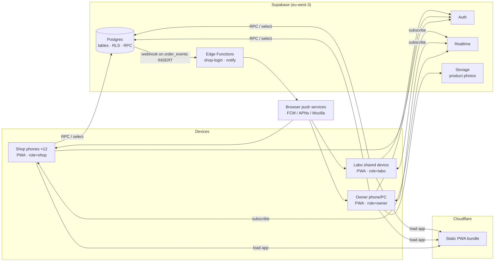
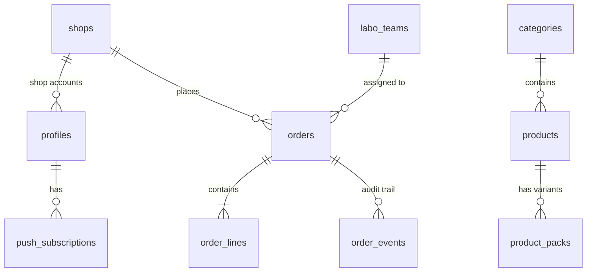

# Architecture

## 1. Decisions at a glance

| Concern | Choice | Why | Rejected alternative |
|---|---|---|---|
| Client | **React 19 + TypeScript 6 + Vite 8**, React Router 8, single PWA with role-based routes | No SEO or SSR needs, so a static SPA is simplest. One codebase serves all three roles. | Next.js (SSR adds no value here and makes offline/PWA harder); native apps (store friction and 3× the work) |
| Styling | **Tailwind CSS 4** (CSS-first: tokens in `src/styles/tokens.css`, exposed via `@theme` in `src/styles/index.css`) | Fast, consistent, accessible primitives. Logical properties give RTL support. | MUI (Material look, the opposite of the iOS style chosen) |
| Sheets & motion | **Vaul** (iOS-style drawer: drag, snap points, rubber-band) + **Motion** (spring animations) | The bottom sheet is the core shop interaction and has to feel native | Hand-rolled sheet (gesture physics are hard to get right) |
| Server state | **TanStack Query** | Caching, retries, refetch on focus/reconnect, optimistic updates | Hand-rolled fetch logic |
| Local state | **Zustand** (cart, UI) persisted to **IndexedDB** (`idb-keyval`) | Cart must survive app kills | localStorage (size limit and synchronous) |
| Backend | **Supabase**: Postgres, Auth, Realtime, Storage, Edge Functions | One managed service covers DB + auth + realtime + files + push sender. No server to operate. | Custom Node API (more code and ops for no gain at this scale) |
| Business rules | **Postgres functions (RPC)** + RLS | State transitions are atomic and audited where the data lives. A buggy client can't corrupt state. | Rules in the client (unsafe), or in Edge Functions (extra hop, no transactions across calls) |
| Realtime | Supabase Realtime `postgres_changes`, **plus refetch on reconnect** | Live status. Realtime alone is not guaranteed delivery, so the refetch is the safety net. | Polling only (slower, wasteful) |
| Push | **Web Push (VAPID)** sent by an Edge Function triggered by a DB webhook on `order_events` | Works on Android and installed iOS PWAs, with no Firebase SDK in the app | FCM SDK (extra dependency, iOS still needs an installed PWA) |
| PWA | `vite-plugin-pwa` (Workbox), `injectManifest` strategy | Custom service worker needed for push + background sync | — |
| Hosting | **Cloudflare Pages** (or Vercel) for the static client. Supabase region **eu-west-3 (Paris)**. | Paris is the closest Supabase region to Algiers (lowest latency, an estimate; to measure in pilot) | — |
| i18n | `i18next` + `react-i18next`, `ar` and `fr`, `dir` set on `<html>` | Mature, supports plurals and RTL switching | — |
| Testing | Vitest (unit), **pgTAP** (RLS + RPC), **Playwright** (E2E across three roles) | The critical risk is data correctness, so the DB is tested directly | — |

**Cost:** starts on the **Supabase free tier** (owner's decision). It stays inside the limits thanks to the 30-day purge (§10). The free tier's missing backups are covered by a nightly `pg_dump` GitHub Action. Upgrade path: Supabase Pro (≈ $25/month, verify current pricing) if the app needs longer history or point-in-time recovery. Cloudflare Pages: free.

### Versions (2026-11-26)

Rule: the **newest stable version that is at least two weeks old and compatible with the rest**, pinned exactly in `package.json`. Re-evaluated on each phase.

| Package | Version | Note |
|---|---|---|
| react / react-dom | 19.3.1 | |
| react-router | 8.5.1 | replaces `react-router-dom` |
| vite / @vitejs/plugin-react | 8.3.8 / 6.3.0 | 8.4.0 was released the same day, so skipped |
| tailwindcss / @tailwindcss/vite | 4.3.5 | |
| typescript | **6.0.3** | not 7.x: `typescript-eslint` supports TypeScript < 6.1 only |
| vitest | 5.1.0 | |
| vite-plugin-pwa / workbox | 2.0.0 / 7.4.1 | |
| eslint / typescript-eslint / react-hooks | 10.14.0 / 8.72.2 / 7.1.1 | |
| @tanstack/react-query | 5.107.1 | |
| i18next / react-i18next | 27.1.1 / 18.0.1 | |
| @supabase/supabase-js | 2.119.0 | |
| Node | 22 (CI and local) | `@types/node` 22 to match |

## 2. System overview



## 3. Data model



### Tables (abridged; the migrations are the source of truth)

```sql
-- enums
create type user_role      as enum ('owner','deputy','shop','labo');
create type quantity_mode  as enum ('count','weight','volume','pack');
create type order_status   as enum ('submitted','in_review','validated','refused',
                                    'in_preparation','ready','received','cancelled');
create type line_decision  as enum ('pending','accepted','reduced','refused');
create type prep_status    as enum ('todo','done','partial','not_done');

shops            (id, slug unique, name_fr, name_ar, sort_order, active)
profiles         (user_id pk→auth.users, role, shop_id null→shops, display_name, locale,
                  check ((role='shop') = (shop_id is not null)))
labo_teams       (id, code unique ('morning','night'), name_fr, name_ar, starts_at time, ends_at time)
                  , pin_hash text, theme text ('sand' | 'night')
                  -- seed: morning 04:00–16:00 sand, night 16:00–04:00 night (PRD Q3/Q13)
categories       (id, slug, name_fr, name_ar, sort_order, active)
products         (id, category_id, name_fr, name_ar null, image_path null,
                  desc_fr varchar(80) null, desc_ar varchar(80) null,   -- optional short description
                  quantity_mode, step int, min_qty int, max_qty int null,
                                    active, sort_order, created_at, updated_at)
product_packs    (id, product_id, label_fr, label_ar, size int, size_unit text, active, sort_order)
refusal_reasons  (id, label_fr, label_ar, sort_order, active)

orders           (id uuid pk  -- generated by the CLIENT (idempotency key)
                  , code text unique         -- human: 'KOU-1125-02'
                  , shop_id, status, business_date date
                  , shop_note varchar(160)   -- owner/deputy notes live in order_notes
                  , assigned_team_id null
                  , submitted_at, submitted_by
                  , review_started_at, reviewed_at, reviewed_by
                  , prep_started_at, ready_at, ready_team_id
                  , received_at, cancelled_at, cancel_reason
                  , version int not null default 1)

order_lines      (id uuid pk, order_id, position int
                  , product_id, pack_id null
                  -- snapshot: frozen at submit time
                  , product_name_fr, product_name_ar, category_id, quantity_mode, pack_label
                  -- quantities in base units (pieces | g | ml | packs), integers
                  , requested_qty int  check (requested_qty > 0)
                  , decision line_decision default 'pending'
                  , approved_qty int null
                  , refusal_reason text null
                  , prep prep_status default 'todo'
                  , prepared_qty int null, labo_note varchar(80) null
                  , prep_updated_at, prep_team_id)

order_events     (id bigserial pk, order_id, line_id null
                  , type text            -- 'submitted','line_decided','validated','line_prepped',...
                  , from_status, to_status
                  , actor_user_id, actor_role, labo_team_id null
                  , device_id text, request_id uuid null
                  , payload jsonb, created_at timestamptz default now())
                  -- REVOKE update, delete FROM everyone; insert only via RPC

order_notes      (id, order_id, line_id null, audience ('labo','shop'),
                  body text check (char_length(body) <= case when line_id is null then 160 else 80 end),
                  author_user_id, created_at)        -- append-only; added during review or after validation

notifications    (id bigserial, recipient_user_id, order_id null, event_id, type, push bool,
                  title_key text, params jsonb, created_at, read_at null)
                  -- written by a trigger on order_events using the matrix in PRD §6.8;
                  -- RLS: each user reads/updates (read_at) only their own rows

daily_totals     (business_date, shop_id, product_id, pack_label null, quantity_mode,
                  product_name_fr, product_name_ar, category_id,
                  lines int, requested int, approved int, prepared int, refused_lines int, problem_lines int,
                  primary key (business_date, shop_id, product_id, pack_label))
daily_shop_stats (business_date, shop_id, orders int, refused_orders int,
                  median_review_s int, median_prep_s int, primary key (business_date, shop_id))
                  -- both written nightly before the purge; kept 13 months (PRD STA-7)

purge_runs       (id, ran_at, cutoff_date, orders_deleted int, lines_deleted int, events_deleted int)

push_subscriptions (id, user_id, endpoint unique, p256dh, auth, device_label, created_at, last_seen_at)
```

Key invariants (enforced with constraints or inside RPCs):
- `approved_qty` is set exactly when `decision in ('accepted','reduced')`, and `0 < approved_qty ≤ requested_qty`. `reduced` implies `approved_qty < requested_qty`.
- `refusal_reason` is required when `decision = 'refused'`.
- `labo_note` is required when `prep in ('partial','not_done')`.
- `pack_id` is required if and only if `quantity_mode = 'pack'`.
- `business_date` = `(submitted_at at time zone 'Africa/Algiers' - interval '4 hours')::date`. The 04:00 cutoff matches the shift change and is configurable.
- Note limits (PRD NOTE-1) are `CHECK` constraints, not only UI rules.
- Retention: **30 days**, enforced by `purge_old_orders()` (§10). Indexes on `(shop_id, business_date)` and `(status, business_date)`.

## 4. Order lifecycle & who can trigger what

Defined in [PRD §9](./PRD.md#9-order-state-machine). Every arrow is exactly one RPC. The function below is the **only** code path allowed to change `orders.status`:

```
transition(order_id, expected_version, from_status[], to_status, event_type, payload)
  → assert caller role/scope
  → SELECT … FOR UPDATE; assert status ∈ from_status AND version = expected_version
  → UPDATE orders SET status, version = version + 1, <timestamps>
  → INSERT order_events(...)
  → RETURN updated order
```

## 5. Server functions (RPC)

All are `SECURITY DEFINER`, set `search_path = public`, and are idempotent on `request_id` where it applies.

| RPC | Role | Effect |
|---|---|---|
| `submit_order(id, lines[], shop_note)` | shop | Validates products/packs are active and quantities fit the min/max/step rules, then snapshots names and inserts `submitted`. **If `id` already exists, it returns the existing order** (idempotent). |
| `update_pending_order(id, version, lines[], note)` | shop | While `submitted` or `in_review`. Diffs against the current lines, resets `decision` on changed or added lines, writes a `shop_edited` event with the diff. A reviewer's next `decide_order` with the old version fails, so the UI reloads and highlights the changes. |
| `add_note(order_id, line_id?, audience, body)` | owner, deputy | Any status from `submitted` to `in_preparation`. Inserts into `order_notes` and writes a `note_added` event. Never changes quantities. |
| `cancel_order(id, version, reason?)` | shop (`submitted`, `in_review`: "delete") / owner, deputy (`validated`, not started) | → `cancelled`. If a reviewer held the lock, they are notified. |
| `start_review(id)` | owner, deputy | `submitted → in_review` (no-op if already `in_review`) |
| `release_review(id)` | owner, deputy | `in_review → submitted` |
| `decide_order(id, version, decisions[], note_labo, note_shop, team_id)` | owner, deputy | Applies every line decision atomically → `validated` or `refused` |
| `set_line_prep(line_id, prep, prepared_qty?, note?, request_id)` | labo | Updates the line. The first one moves the order `validated → in_preparation`. Last-write-wins per line (single tablet), idempotent by `request_id`. |
| `close_order(id, version)` | labo | Requires no `todo` lines → `ready` |
| `confirm_received(id)` | shop | `ready → received` |
| `mark_notifications_read(ids[] \| 'all')` | any | Sets `read_at` on the caller's own notifications. |
| `stats_range(from, to, shop_id?, category_id?, product_id?)` | owner, deputy (any shop) · shop (forced to own shop) | Reads `daily_totals` / `daily_shop_stats` + live data for today. Returns tiles, per-day series, top products, per-shop rows. |
| `switch_labo_team(team_id, pin)` | labo | Checks the team PIN (bcrypt, rate-limited), stores the active team for the tablet session server-side, and logs `labo_team_switched`. Every labo RPC reads the active team from the server, never from the client. |

## 6. Realtime & consistency

```
Shop:   channel orders:shop_id=eq.<id>      → invalidate ['orders', shopId]
Owner/deputy:  channel orders (all)                → invalidate inbox / board
        channel order_lines (all)           → live progress during preparation
Labo:   channel orders:status=in.(validated,in_preparation,ready)
```

Rules:
1. A Realtime message is a **hint to re-fetch**, never the data itself. This avoids partial or out-of-order payloads.
2. Re-fetch on `visibilitychange`, `online`, and Realtime `SUBSCRIBED` after a reconnect.
3. Mutations are optimistic in the UI but **roll back** on RPC error and show a clear toast.
4. A version conflict (`P0001: stale_version`) triggers a re-fetch and the message "La commande a changé, vérifiez."

## 7. Offline & no-data-loss design

| Data | Where it lives before the server confirms | Replay |
|---|---|---|
| Shop cart | Zustand → IndexedDB, written on every change | Stays until submit succeeds |
| Pending submit | **Outbox** (IndexedDB), keyed by order UUID | On `online` / app start / Background Sync. Safe to repeat because `submit_order` is idempotent. |
| Labo tick | Outbox, keyed by `request_id` | Replayed in order. Same `request_id` applied twice = same result. |
| Owner decision | Not queued offline (the owner must see the current state). The button is disabled while offline. | — |

The outbox shows a visible badge ("2 actions en attente d'envoi"). Nothing is silently dropped. A failed replay for a business-rule reason (e.g. product deactivated) surfaces in the UI with a fix-up action.

## 8. Notifications

One pipeline feeds both the **notification centre** and **push**:

```mermaid
sequenceDiagram
    participant RPC as Order RPC
    participant DB as Postgres
    participant EF as Edge Fn notify
    participant PS as Push service
    participant D as Device
    RPC->>DB: INSERT order_events
    DB->>DB: trigger → INSERT notifications (one row per recipient, per PRD §6.8 matrix)
    DB-->>D: Realtime on notifications → bell count, in-app banner
    DB->>EF: webhook on notifications where push = true
    EF->>PS: web-push (VAPID), tag = order_id, TTL 1h
    PS->>D: system notification; tap → /orders/:id
    EF->>DB: delete dead subscriptions (404/410)
```

- **Recipients** are resolved in SQL (`notify_recipients(event)`), never by the client. No row for the actor of the event.
- **Push copy** is built in the Edge Function from `title_key` + `params` in the recipient's `locale`.
- **Scheduled pushes** (pg_cron, every 5 min): order unopened > 15 min → owner/deputy reminder (once per order); handover not confirmed 15 min after 04:00/16:00 → owner.
- **Sounds** play in the app only (owner chime on `submitted`, labo alarm on `validated` until opened, short tone on `note_added`).
- **iOS**: push requires the installed PWA (iOS ≥ 16.4); the install guide is shown until the app runs standalone.

## 9. Repository layout

Scaffolded in Phase 0. Every folder exists in the repo; `features/*/README.md` lists the PRD IDs it owns.

```
/
├─ CLAUDE.md · README.md · package.json · pnpm-lock.yaml
├─ index.html · vite.config.ts · tsconfig*.json · eslint.config.js   (no tailwind/postcss config: Tailwind 4 is configured in CSS)
├─ .env.example                      VITE_SUPABASE_URL, VITE_SUPABASE_ANON_KEY, VITE_VAPID_PUBLIC_KEY
├─ docs/                             PRD · ARCHITECTURE · DESIGN_SYSTEM · ROLES
├─ prototype/index.html              visual reference (v0, superseded by docs where they differ)
├─ public/                           icons, splash screens
├─ supabase/
│  ├─ migrations/                    timestamped SQL: schema, RLS, RPCs, triggers, cron jobs
│  ├─ functions/                     shop-login/ · notify/  (Deno edge functions)
│  ├─ tests/                         pgTAP: rls_*.sql · rpc_*.sql · purge_*.sql
│  └─ seed.sql                       12 shops, 10 categories, 2 teams, refusal reasons
├─ src/
│  ├─ main.tsx                       entry: fonts, styles, i18n, providers
│  ├─ app/                           App.tsx (routes per role) · providers.tsx · RoleGuard.tsx
│  ├─ components/ui/                 design-system components only (StatusPill, Sheet, Stepper, NoteBubble…)
│  ├─ features/
│  │  ├─ auth/                       shop PIN login, owner login, labo device login
│  │  ├─ catalog/                    owner: products, packs, photos, availability       CAT-*
│  │  ├─ ordering/                   shop: catalogue, product sheet, cart, send          SHP-*
│  │  ├─ tracking/                   shop: my orders, detail, received                    TRK-*
│  │  ├─ review/                     owner/deputy: inbox, review                          OWN-*
│  │  ├─ followup/                   owner/deputy: Suivi filters, detail, timeline        FOL-*
│  │  ├─ labo/                       list, order, problem sheet, handover                 LAB-*
│  │  ├─ notes/                      note icon/bubble/sheet logic                         NOTE-*
│  │  ├─ notifications/              bell, centre, in-app banner, push subscription       NTF-*
│  │  └─ stats/                      Activité (owner + shop)                              STA-*
│  ├─ lib/                           supabase.ts · quantity.ts · time.ts · limits.ts · queryKeys.ts · i18n.ts · outbox.ts · shareText.ts
│  ├─ locales/                       fr.json · ar.json
│  ├─ styles/                        tokens.css (DESIGN_SYSTEM §2) · index.css
│  ├─ types/database.ts              generated by `supabase gen types`, never hand-edited
│  └─ sw.ts                          service worker: precache, push, notification click, background sync
├─ e2e/                              Playwright: shop → owner → labo → shop
└─ .github/workflows/                ci.yml (typecheck · lint · unit · build) · db.yml (pgTAP) · backup.yml
```

## 10. Retention & backup (free tier)

```sql
-- pg_cron, daily 03:00 Africa/Algiers (= 02:00 UTC)
select cron.schedule('purge-old-orders', '0 2 * * *', $$ select purge_old_orders(30) $$);
```

`aggregate_day(date)` runs first and is idempotent (upsert). Aggregates older than 13 months are dropped by the same job.

`purge_old_orders(days)` is `SECURITY DEFINER`, owned by a dedicated role, and not executable by any app role. It deletes orders with `business_date < business_today() - days` and a final status (`received`, `ready`, `refused`, `cancelled`). Lines, notes and events go with them (`ON DELETE CASCADE`). It writes one `purge_runs` row. **This is the only code allowed to delete from `order_events`.** A pgTAP test proves it never touches open orders or anything younger than 30 days.

Backup: `.github/workflows/backup.yml` runs nightly. It does `pg_dump --format=custom` with the `SUPABASE_DB_URL` secret, uploads the file as an artifact with `retention-days: 30`, and fails loudly if the dump is empty.

Product photos: compressed in the browser to WebP ≤ 200 KB before upload, and cached by the service worker. This saves the free tier's storage and bandwidth.

## 11. Environments & delivery

| Env | Supabase | Client | Purpose |
|---|---|---|---|
| local | `supabase start` (Docker) | `vite dev` | Development + pgTAP |
| staging | separate project | preview deploy per PR | Owner acceptance testing |
| production | Free tier (Paris) at launch; Pro if history or PITR is needed | main branch | Live |

CI on every PR runs `tsc --noEmit`, ESLint, Vitest, `supabase test db`, and Playwright against local Supabase. Migrations reach staging automatically and production only on manual approval.

## 12. Observability

- Sentry (or similar) for client errors, tagged with role and shop.
- `order_events` doubles as the business log. The owner's order timeline (PRD FOL-3) reads it.
- Health checks: orders stuck in `submitted` for more than 30 min, or `validated` for more than 2 h, flag a warning on the owner board.
