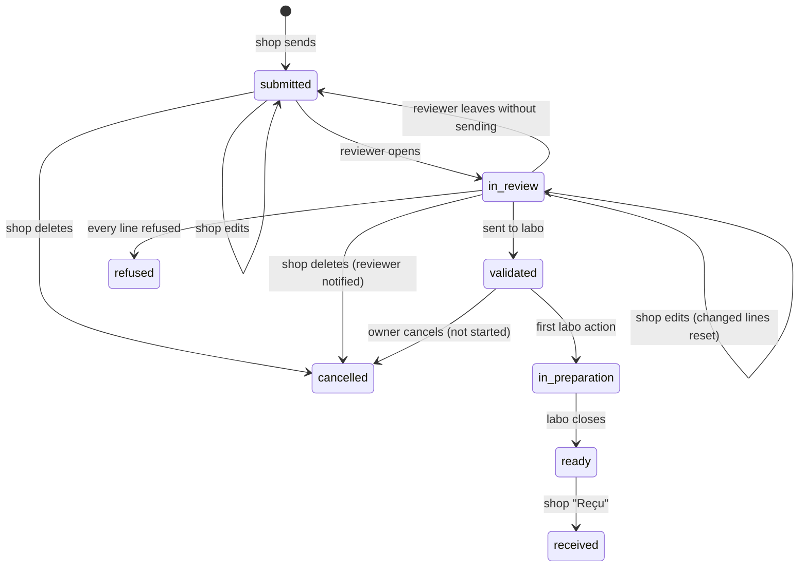

# Mahroussa Pro: Product Requirements

| | |
|---|---|
| Status | **v1.0**, ready to build |
| Last updated | 2026-11-26 |
| Visual reference | `prototype/index.html` (look and flow). **This document wins** where they differ. |

---

## 1. Problem

El Mahroussa runs 12 shops supplied by one central kitchen (the **labo**). Today an order is a WhatsApp voice note to the owner. He retypes it into a WhatsApp group for the morning or night team, a preparer copies it into a paper register, ticks it on a phone, then phones the owner, who phones the shop. The same order is written four times by hand. Nobody can see its status without calling someone, and nothing records who decided what. Long orders break in WhatsApp.

## 2. Goal and scope

One digital order goes **shop → owner → labo → shop**. Every step is visible to the people concerned as it happens, and nothing is copied by hand between shop and labo.

- **In scope:** catalogue, ordering, review, preparation, tracking, notes, notifications, statistics on **quantities**.
- **Out of scope, permanently:** prices, payment, invoicing, stock, delivery logistics, HR.
- **Unchanged on purpose:** the owner keeps entering the day's orders into his own PC database. The app has no export.

## 3. Success metrics

| Metric | Target | Measured by |
|---|---|---|
| Orders lost or altered | **0** | Event trail per order (§9) |
| Shop time to place an 8-line order | **< 60 s** median | first add → `submitted_at` |
| Owner review time | **< 30 s** median | `review_started_at` → `reviewed_at` |
| Validation → labo sees it | **< 10 s** | `validated_at` → first labo fetch |
| Adoption | 100% of orders in the app **2 weeks** after a shop goes live | WhatsApp ordering stopped |

These targets are assumptions. Re-baseline them after the pilot week.

## 4. Users and devices

| Role | Who | Device | Context |
|---|---|---|---|
| **Shop** ×12 | Shop manager | Own phone, app installed | Busy, low patience, low tech comfort. Arabic first. |
| **Owner** ×1 | The owner | Phone (+ PC) | Every order passes through him. Wants speed, clear notifications and an overview. |
| **Deputy** ×1 | Owner's backup | Phone | Reviews when the owner is unavailable. No catalogue or account admin. |
| **Labo** ×2 teams | Morning 04:00–16:00, night 16:00–04:00 | **One shared device** (phone or tablet). UI is **phone-first** | Wet hands, noise. The owner must know which team did what. |

Permissions: [ROLES.md](./ROLES.md).

## 5. Core flow

```mermaid
sequenceDiagram
    participant S as Shop
    participant O as Owner / Deputy
    participant L as Labo
    S->>O: Submit (En attente)
    Note over S: can edit or delete until sent to labo
    O->>O: Lines accepted by default; pen = reduce, × = refuse, note
    alt at least one line kept
        O->>L: Send to labo (team + notes)
        Note over S: Acceptée
        L->>L: Tick lines · "Problème" on a line → partial / not prepared + reason
        L->>O: Close → Prête
        Note over O,S: notified: ready to collect
        S->>O: "Reçu" → Livrée
    else every line refused
        O-->>S: Refusée (+ reasons)
    end
```

## 6. Requirements

Priority: **P0** pilot · **P1** before all 12 shops · **P2** later.

### 6.1 Catalogue (owner)

| ID | Requirement | P |
|---|---|---|
| CAT-1 | 10 fixed categories in this order: Glaces, Crêpes, Kachtouta, Pâtisserie, Pizza, Jus, Fruits, Suppléments, Ingrédients, Emballage (FR + AR names). Owner can hide one, not delete it. | P0 |
| CAT-2 | Product: FR name, AR name, category, **photo**, **short description** (optional, FR + AR, **max 80 characters**), quantity type (§7), step or packs, active flag. | P0 |
| CAT-3 | Pack products: list of packs (e.g. 5 L, 10 L), each switchable on/off without deleting it. | P0 |
| CAT-4 | Unavailable product: **greyed out** in the shop catalogue with the word "Indisponible", not orderable. | P0 |
| CAT-5 | Photo upload compressed in the browser to WebP ≤ 200 KB. | P0 |
| CAT-6 | Catalogue edits never change existing orders (lines store a snapshot). | P0 |
| CAT-7 | Owner and deputy can toggle availability. Only the owner creates or edits products. | P0 |

### 6.2 Ordering (shop)

| ID | Requirement | P |
|---|---|---|
| SHP-1 | Device stays logged in. Login once: pick shop → 6-digit PIN. | P0 |
| SHP-2 | Catalogue screen: **filter chips** (Tout · Habituels · 10 categories) + search behind an icon. "Habituels" = products this shop ordered in the last 30 days. | P0 |
| SHP-3 | **Uniform product cards**: every card has the same size and shows only **photo + name**. A **"+"** button sits on the photo corner. | P0 |
| SHP-4 | Product **in the cart**: the "+" becomes a **quantity badge** in the same place (e.g. `150`, `500 g`, `10 L × 3`; two pack lines show `2 packs`), plus a green ring around the card. **The card's size never changes.** | P0 |
| SHP-5 | Tapping "+", the badge or the card opens the **product sheet**: photo, name, short description (if any), and the quantity control for its type (§7). Button: "Ajouter · 150" / "Mettre à jour · 150". In the cart a trash icon removes the line. | P0 |
| SHP-6 | Floating cart bar (count + "Panier"). Cart screen: lines with steppers, optional **note to the owner (max 160 characters)** behind a note icon, "Envoyer". | P0 |
| SHP-7 | Cart saved on the device after every change (survives app kill and refresh). | P0 |
| SHP-8 | Sending is idempotent (client UUID). Offline sends are queued and sent automatically, and the order shows a "queued" icon until confirmed. | P0 |
| SHP-9 | Several orders per day are allowed. | P0 |

### 6.3 My orders (shop)

| ID | Requirement | P |
|---|---|---|
| TRK-1 | The Commandes tab is grouped, in this order: **À récupérer** (ready: solid green, always first) → **En cours** (waiting, accepted, preparing) → **Terminées** (received, refused, cancelled; collapsed, last 30 days). | P0 |
| TRK-2 | Status pill with one colour per step (DESIGN_SYSTEM §2). | P0 |
| TRK-3 | **While "En attente"** (submitted or in review): the card shows a **pen** (edit, which reloads the cart) and a **trash** icon (delete). Delete asks for confirmation ("Supprimer la commande ?" / Supprimer · Annuler) because it can't be undone. Neither icon appears once the order is sent to the labo. | P0 |
| TRK-4 | Order detail: 4-step progress (Envoyée → Acceptée → Préparation → Prête) with times. Each line has a state icon. Reduced quantities show the original struck through. Refused lines show the reason. Labo problems show partial quantity and reason. | P0 |
| TRK-5 | "Reçu" button on a ready order → **Livrée**. | P0 |
| TRK-6 | Live updates without refresh. Re-fetch on focus and reconnect. | P0 |
| TRK-7 | Shop statistics (STA-6). | P1 |

### 6.4 Review (owner, deputy)

| ID | Requirement | P |
|---|---|---|
| OWN-1 | Inbox "À valider": oldest first, with shop name, waiting time (turns wood-coloured after 10 min), line count, and a note icon if the shop left a note. | P0 |
| OWN-2 | Opening an order locks it (`in_review`). The other reviewer sees who holds it. | P0 |
| OWN-3 | **Every line is accepted by default.** Line icons: **pen** (reduce with a stepper, never above the request), **note** (note for the labo), **×** (refuse with a preset reason or free text). A refused line shows **undo**. | P0 |
| OWN-4 | Footer: team (sun Matin / moon Nuit, default from the clock) + order note for the labo (icon) + **"Envoyer au labo"**. If every line is refused, the button becomes "Refuser la commande". | P0 |
| OWN-5 | If the shop edits the order during review, a banner says so and changed lines are highlighted. Decisions on changed lines reset. | P0 |
| OWN-6 | After validation, quantities are frozen. The owner can still **add notes** (order or line) until the order is ready. | P1 |
| OWN-7 | "Partager" icon: order as plain text through the phone's share sheet (WhatsApp fallback). | P0 |
| OWN-8 | Reminder push if an order waits more than 15 min unopened. | P1 |

### 6.5 Follow-up (owner, deputy)

| ID | Requirement | P |
|---|---|---|
| FOL-1 | "Suivi" tab with **filter chips and counts**: Tout · **Acceptées** (not started) · **En préparation** · **Prêtes** (waiting for pickup) · **Livrées** (received today). | P0 |
| FOL-2 | Cards: shop, status pill, team icon, progress x/y, time since validation. A labo problem on any line shows a wood warning icon. | P0 |
| FOL-3 | Detail: lines with prep state, labo reasons, notes (bubble cards), full event timeline (who and when, team stamps). | P0 |

### 6.6 Labo

| ID | Requirement | P |
|---|---|---|
| LAB-1 | Device stays logged in. Screen kept awake. | P0 |
| LAB-2 | **Team themes and handover**: Matin = light sand, Nuit = dark green. At **04:00 and 16:00** a full-screen handover blocks the device until the incoming team picks itself and enters its **4-digit team PIN** (set by the owner). Early handover is available from the header. Every action is stamped with the team. | P0 |
| LAB-3 | Order list grouped: **Nouvelles** first (wood card, alarm sound repeating until opened, count in a top banner) → **En préparation** → **Prêtes aujourd'hui** (collapsed). Sent-but-unstarted orders stay in "Nouvelles" until opened. | P0 |
| LAB-4 | Open an order: full screen, owner notes as bubble cards, one big row per line. **Tap a row = prepared** (tap again = undo). | P0 |
| LAB-5 | **"Problème" icon** (warning triangle) on each line opens a sheet titled **"Problème · ‹produit› · ‹qty›"** with two large choices: **"Préparé en partie"** (stepper "Préparé : 20 / 40") and **"Pas préparé"**. Then a reason (chips: Rupture · Pas le temps · Panne, or text up to 80 characters), then "Enregistrer". The sheet always uses the light theme, so it stays readable in the night theme. | P0 |
| LAB-6 | Bottom button shows progress (`3/5`) and becomes **"Clôturer"** when every line is resolved. | P0 |
| LAB-7 | Offline ticks are queued and replayed idempotently. | P0 |

### 6.7 Notes

| ID | Requirement | P |
|---|---|---|
| NOTE-1 | Who writes: shop → owner (order, **160** chars) · owner → labo (order **160**, line **80**) · labo → owner/shop (line reason **80**). Hard limits with a live counter. The server rejects anything longer. | P0 |
| NOTE-2 | **No note, no icon.** When a note exists, a note icon appears on the line or card. Tapping it opens a **floating bubble card** (author, time, text). Text wraps on any character, so a long word can't overflow. The card closes on tap outside. | P0 |
| NOTE-3 | Labo order view: order-level notes appear as a bubble at the top. Line notes appear only through their icon. | P0 |

### 6.8 Notifications

| ID | Requirement | P |
|---|---|---|
| NTF-1 | Three channels, used by **importance**: **push** (phone notification), **in-app banner** (while the app is open), **badge** (counts on tabs and the bell). Sound only for the labo alarm and the owner's new-order chime. | P0 |
| NTF-2 | **Notification centre**: a bell in each header with an unread count. Opens a list (icon, one short sentence, time). Tap → opens the order and marks it read. Keeps 30 days. | P0 |
| NTF-3 | Matrix (✱ = push, ○ = banner + badge only): see below. | P0 |
| NTF-4 | One push per order at a time: a newer push for the same order **replaces** the older one (`tag = order id`). No push for your own actions. | P0 |
| NTF-5 | Texts are short, start with the shop or order, and are translated (FR/AR). Examples: "Kouba · nouvelle commande (4)", "EMD-03 · acceptée, 1 ligne modifiée", "EMD-03 · prête à récupérer". | P0 |

| Event | Owner / Deputy | Shop | Labo |
|---|---|---|---|
| Order submitted | ✱ + chime | — | — |
| Shop edited / deleted a waiting order | ✱ if he had opened it, else ○ | — | — |
| Order waiting > 15 min | ✱ reminder | — | — |
| Sent to labo | — | ✱ (mentions reduced/refused lines) | ✱ + alarm |
| Refused | — | ✱ | — |
| Preparation started | ○ (Suivi) | ○ | — |
| Line problem (partial / not prepared) | ○ | — | — |
| Owner note after validation | — | — | ✱ + short tone |
| Ready | ✱ | ✱ "prête à récupérer" | — |
| Received (delivered) | ✱ | — | — |
| Handover not confirmed 15 min after 04:00/16:00 | ✱ | — | (handover screen) |

### 6.9 Statistics (quantities only)

| ID | Requirement | P |
|---|---|---|
| STA-1 | Owner tab **"Activité"**: period **Jour · Semaine · Mois** with a ‹ › navigator (e.g. "Semaine 48", "Novembre"). | P1 |
| STA-2 | Filters: **shop** (all or one), **category**, **product**, and a **day** picker inside week/month. | P1 |
| STA-3 | Summary tiles: orders, lines, refused lines (%), labo problems, median time to validation, median time to ready. | P1 |
| STA-4 | Per-day bars (orders per business day). **Top products** list: total quantity per product in its own unit (pieces / kg / L / packs per size), and how many shops ordered it. **Per shop** list: orders, lines, refused. Tap a product → per-day and per-shop breakdown. | P1 |
| STA-5 | A daily recap of everything sent to the labo, grouped by shop, to make the owner's PC entry faster (read-only, shareable as text). | P1 |
| STA-6 | Shop sees the same views **for its own shop only** (week/month, per product, per day). | P1 |
| STA-7 | Statistics read **daily aggregates** that are kept **13 months**, so month views and comparisons still work after the 30-day order purge (§6.10). | P1 |

### 6.10 Retention and backup

| ID | Requirement | P |
|---|---|---|
| RET-1 | Orders with a final status older than 30 days are deleted nightly (03:00), together with their lines, notes, events and notifications. Open orders are never deleted. | P0 |
| RET-2 | Before purging, the nightly job writes daily aggregates (STA-7). | P1 |
| RET-3 | Nightly `pg_dump` backup kept 30 days (GitHub Action), because the Supabase free tier has no backups. | P1 |

## 7. Quantity model

| Type | Example | Stored as (integer) | Shop sheet control |
|---|---|---|---|
| `count` | Cornets | pieces | Stepper by the owner's step (e.g. ±10), starting at one step |
| `weight` | Pistache | grams | Stepper by step (e.g. ±250 g), shown as g / kg |
| `volume` | Pâte à crêpe | millilitres | Stepper by step (e.g. ±1 L), shown as ml / L |
| `pack` | Chantilly 5 L / 10 L | number of packs, per pack | Segmented pack choice (active packs only) + stepper ±1 |

- Per-product settings: `step` (also the minimum) and optional `max`. No quick-value buttons and no free typing.
- Long-press on +/− repeats (fast for big quantities).
- The same pack product can be in the cart with several packs (one line each).

## 8. State machine



| State | Shop label | Owner "Suivi" filter |
|---|---|---|
| submitted, in_review | En attente | (inbox) |
| validated | Acceptée | Acceptées |
| in_preparation | En préparation | En préparation |
| ready | Prête à récupérer | Prêtes |
| received | Livrée | Livrées |
| refused / cancelled | Refusée / Supprimée | — |

## 9. Data integrity (non-negotiable)

1. Postgres is the single source of truth.
2. Every state change goes through one server function that checks role, scope, status and `version`, and writes the change **and** an `order_events` row in one transaction.
3. `order_events` is append-only (only the retention job deletes).
4. Idempotent client UUIDs and request IDs make retries safe.
5. Stale writes are rejected (`version`) and the UI reloads. Nothing is silently overwritten.
6. Cart and pending actions persist on the device until confirmed.
7. Note length limits are enforced in the database, not only in the UI.

## 10. Non-functional

| Area | Requirement |
|---|---|
| Platform | Installed PWA on Android Chrome and iOS Safari ≥ 16.4 (home screen needed for iOS push; first launch shows a 3-step install guide). |
| Performance | First load < 3 s on mid-range Android over 4G. Taps respond < 100 ms. Shop bundle < 250 KB gzip (excluding photos). |
| Offline | App shell, catalogue and photos cached. Cart, send and labo ticks work offline. |
| Languages | Arabic (RTL) and French per user. Arabic default for shop and labo, French for the owner. |
| Time | Stored UTC, shown in `Africa/Algiers`. **Business day starts 04:00.** |
| Accessibility | Targets ≥ 44 px (labo rows ≥ 68 px). Text contrast ≥ 4.5:1. Status always has a word. |
| Hosting | Supabase free tier (Paris) + Cloudflare Pages. ~500 MB database / 1 GB storage limits (verify current values); stays small thanks to RET-1. |
| Security | RLS on every table. Shops see only their own data. PIN logins rate-limited. |

## 11. Release plan

| Phase | Content | Exit |
|---|---|---|
| 0 Foundations | Repo scaffold, CI, Supabase project, schema + RLS + RPCs + tests, seed, logins | pgTAP green |
| 1 Catalogue | Owner product CRUD, photos, packs, availability | Real catalogue entered |
| 2 Ordering | Shop catalogue, product sheet, cart, offline send, my orders | 0 duplicate/lost orders in chaos tests |
| 3 Review & follow-up | Inbox, review, Suivi filters, notes | E2E flow on staging |
| 4 Labo | Phone-first list/detail, problem sheet, handover | Real shift dry-run |
| 5 Notifications | Push, centre, badges, sounds | Push received on all pilot phones |
| **Pilot** | 2 shops, 1 week, "Partager" as fallback | §3 measured |
| 6 Stats & retention | Aggregates, Activité, shop stats, purge, backup | Month view correct after a purge |
| 7 Rollout | Remaining 10 shops in 2–3 waves | WhatsApp ordering stopped |

## 12. Decisions log

| Date | Decision |
|---|---|
| 11-25 | Deputy role (1). Several orders/day. Unavailable = greyed. Team only, no names. 04:00/16:00 shifts. Owner sets team PINs. Arabic + French. |
| 11-25 | No "Recommander", no export, no quick-value buttons. 30-day retention on the free tier + nightly backup. |
| 11-25 | Brand palette and Readex Pro. Functional icons replace sentences. Auto-accept review with pen / note / ×. |
| 11-26 | Labo phone-first. Uniform cards; quantity as a badge on the photo; "+" opens the product sheet with an optional short description. Shop can edit **and delete** while waiting. Grouped lists (new first) for shop and labo. Owner "Suivi" filters. Statistics for owner and shop. Notes as floating bubbles with length limits. Notification matrix. |

### Open

| # | Question | Default |
|---|---|---|
| Q15 | Statistics: keep daily aggregates 13 months (≈ 10–30 MB, estimate)? | Yes |
| Q16 | Should the owner be able to mute some push types? | No (V1 matrix is fixed) |
