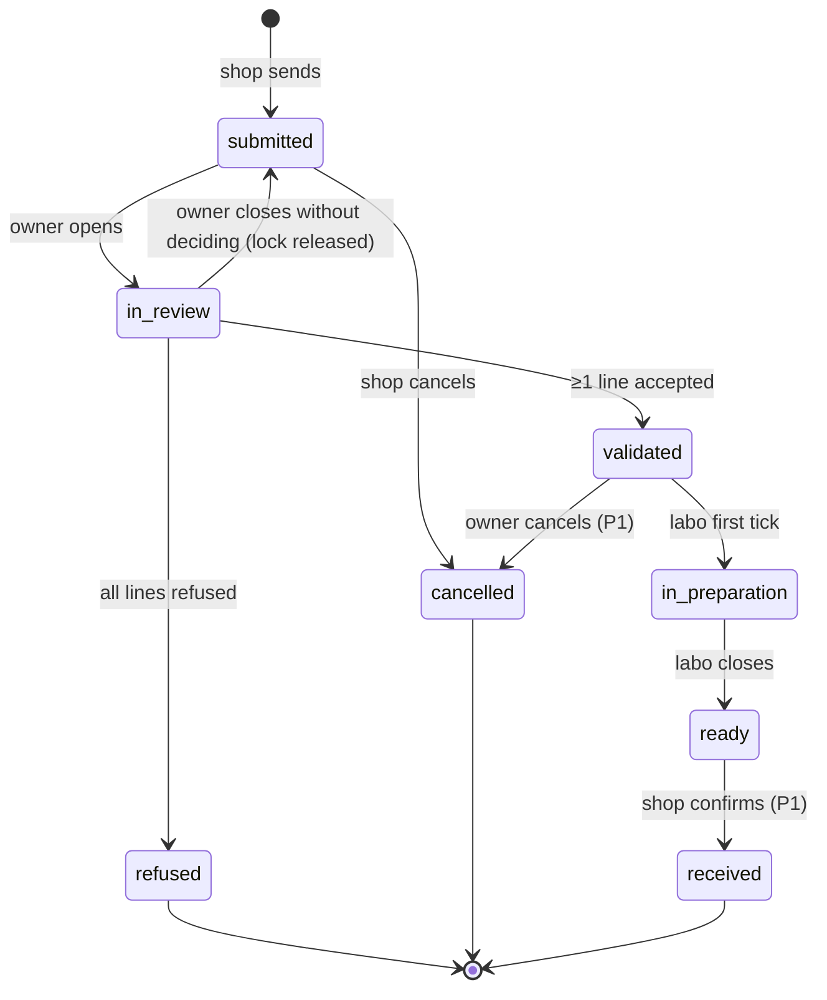

# Mahroussa Pro — Product Requirements Document

| | |
|---|---|
| Status | Draft v0.2 — owner answers integrated; 4 questions still open (see §12) |
| Last updated | 2026-11-25 |
| Scope | V1 (pilot → 12 shops) |

---

## 1. Problem

El Mahroussa runs 12 shops supplied by one central kitchen (the **labo**). Today an order goes through this chain:

1. Shop manager sends a WhatsApp voice note or text to the owner.
2. Owner rewrites it and posts it to a WhatsApp group (one group for the morning team, one for the night team).
3. A preparer copies the message into a paper register.
4. Preparers tick lines on a phone as they prepare.
5. When done, someone **calls** the owner, who **calls** the shop manager to come and collect.
6. Later, the owner re-types the register into a database on his PC.

The same order is written down **four times** by hand (voice → owner message → register → PC). Each copy is a chance to lose or change a line. Nobody can see an order's status without calling someone, and nothing records who decided what or when.

## 2. Goal

Have **one digital order** go from shop → owner → labo, with each step visible to everyone involved as it happens, and nothing copied by hand between the shop and the labo.

**Unchanged on purpose:** the owner keeps entering the day's orders into his own PC database. The app doesn't replace that step.

**Explicitly out of scope:** prices, payment, invoicing, stock and inventory, delivery logistics, HR and timesheets.

## 3. Success metrics

| Metric | Target | How it's measured |
|---|---|---|
| Orders lost or changed in transit | **0** | Every order has an event trail (§8) and no line exists outside the DB |
| Time for a shop to place a typical order (~8 lines) | **< 60 s** median | `submitted_at − first line added` (client timestamp) |
| Adoption | 100% of orders in the app by **2 weeks** after a shop goes live | Owner confirms WhatsApp ordering has stopped |
| Owner review time per order | **< 30 s** median | `reviewed_at − review_started_at` |

These targets are **assumptions** set to steer design. Replace them with real numbers after one week of pilot data.

## 4. Users & context

| Role | Who | Device | Context & constraints |
|---|---|---|---|
| **Shop** (×12) | Shop manager, sometimes other staff | Their own Android phone, sometimes iPhone | Low patience and low tech literacy. Busy, standing, one hand free. Will drop back to WhatsApp at the first friction. Arabic first, product names often in French. |
| **Owner** (×1) | The owner | Phone (+ PC sometimes) | Every order passes through him. Needs speed, batch actions and reliable notifications. Manages the catalog. |
| **Deputy** (×1+) | Owner's backup | Phone | Validates orders when the owner is unavailable (asleep, travelling). Same review powers, no catalog or account admin. |
| **Labo** (×2 teams) | Morning team, night team | **One shared tablet**, always on, in a kitchen | Wet or floured hands, noise, gloves. Night shift crosses midnight. The owner must know which team did what. |

Full permissions are in [ROLES.md](./ROLES.md).

## 5. Core flow

```mermaid
sequenceDiagram
    participant S as Shop
    participant O as Owner
    participant L as Labo
    S->>O: Submit order (🟠 En attente)
    Note over O: push notification
    O->>O: Review line by line<br/>accept / reduce / refuse + reason
    alt at least one line accepted
        O->>L: Validate → assigned team (+ note for labo)
        Note over S: 🟢 Acceptée (refused lines show reason)
        Note over L: sound + push
        L->>L: Tick lines · note on lines not completed
        L->>O: Close order (Prête)
        Note over O,S: push: order ready
        S->>S: Confirm received
    else every line refused
        O-->>S: 🔴 Refusée (+ reasons)
    end
```

## 6. Functional requirements

Priority: **P0** = required for the pilot; **P1** = required before all 12 shops go live; **P2** = later.

### 6.1 Catalog management (Owner)

| ID | Requirement | P |
|---|---|---|
| CAT-1 | 10 fixed categories, in this order: Glaces, Crêpes, Kachtouta, Pâtisserie, Pizza, Jus, Fruits, Suppléments, Ingrédients, Emballage. Each has a French and an Arabic name. The owner can reorder them and hide them, but cannot delete them in V1. | P0 |
| CAT-2 | Create and edit a product: FR name, AR name (optional, falls back to FR), category, optional photo, sort order, active flag. | P0 |
| CAT-3 | Choose the product's **quantity mode** (§7), which controls exactly what the shop sees. | P0 |
| CAT-4 | For `pack` products, define pack variants (e.g. 5 L, 10 L). Each variant can be **switched off and on** at any time without deleting it. | P0 |
| CAT-5 | Turn a product off (unavailable). The shop sees it greyed out with the label "Indisponible" and cannot add it. (Default choice; see Q4.) | P0 |
| CAT-6 | Photo upload with client-side compression (max ~200 KB, WebP). | P1 |
| CAT-7 | Changes to the catalog never alter orders already placed: each order line stores a **snapshot** of the product. | P0 |

### 6.2 Ordering (Shop)

| ID | Requirement | P |
|---|---|---|
| SHP-1 | The device stays logged in permanently. No login on each visit. | P0 |
| SHP-2 | Home screen: category tiles with icons. Search across all products, matching FR and AR names. | P0 |
| SHP-3 | Tapping a product opens a bottom sheet with that product's quantity control (§7). One tap on a quick button adds it to the cart. | P0 |
| SHP-4 | A cart bar stays visible: line count and an **"Envoyer"** button. | P0 |
| SHP-5 | Before sending, show a review screen listing every line, editable, with an optional note to the owner. One confirmation tap sends. | P0 |
| SHP-6 | The cart is saved on the device after every change, so it survives app kills, refreshes and dead batteries. | P0 |
| SHP-7 | Sending is **idempotent**: a double tap, a retry or a flaky network can never create two orders. | P0 |
| SHP-8 | Sending while offline queues the order and sends it automatically when the connection returns. The UI says so clearly ("En file d'attente — sera envoyée"). | P0 |
| SHP-10 | Favourites / "souvent commandés" row at the top of the home screen, computed from the shop's history. | P1 |
| SHP-11 | Edit or cancel the order while it is still `submitted` (the owner hasn't opened it). Once the owner opens it, it is locked. | P1 |
| SHP-12 | **"Partager"** fallback: send the cart or an order as compact plain text through the phone's share sheet (WhatsApp, SMS…), with copy to clipboard as backup. Works offline, because the cart is on the device. | P0 |

### 6.3 Tracking (Shop)

| ID | Requirement | P |
|---|---|---|
| TRK-1 | Order list with status shown by **colour + icon + word** together, never colour alone: 🟠 En attente · 🟢 Acceptée · 🔴 Refusée. | P0 |
| TRK-2 | Order detail: each line shows requested qty → approved qty. Reduced lines are highlighted. Refused lines show the owner's reason. | P0 |
| TRK-3 | Sub-states inside green: *En préparation* → *Prête à récupérer* → *Reçue*. | P0 |
| TRK-4 | Updates arrive live, with no refresh needed. On reconnect or app focus, data is re-fetched. | P0 |
| TRK-5 | Push notification when the order is accepted, refused, or **ready to collect**. This replaces the owner→shop phone call. | P0 |
| TRK-6 | "Reçue" button: the shop confirms pickup, which closes the trail. | P1 |
| TRK-7 | Notes the labo left on lines it could not complete are shown to the shop. | P1 |

### 6.4 Review & dispatch (Owner)

| ID | Requirement | P |
|---|---|---|
| OWN-1 | Inbox of all incoming orders from the 12 shops, oldest first, with the shop name and how long each has waited. | P0 |
| OWN-2 | Push notification for each new order, plus an in-app sound and badge. | P0 |
| OWN-3 | Opening an order sets it to `in_review`, which locks shop edits. | P0 |
| OWN-4 | For each line: **Accepter** (default) / **Réduire** (stepper using the same quantity control) / **Refuser** (preset reasons + free text). | P0 |
| OWN-5 | **"Tout accepter"**: every line is accepted unless the owner touched it. This is the fast path for the common case. | P0 |
| OWN-6 | Optional note for the labo (per order) and optional note for the shop. | P0 |
| OWN-7 | Assign the order to a labo team. The default comes from the current time against the team schedules, and the owner can override it. | P0 |
| OWN-8 | If every line is refused, the order becomes `refused` and is never sent to the labo. | P0 |
| OWN-9 | Live board of orders being prepared: progress (x/y lines), assigned team, elapsed time. | P0 |
| OWN-10 | Push notification when the labo closes an order. Lines the labo could not complete are highlighted. | P0 |
| OWN-11 | Manage the preset refusal reasons (e.g. "Rupture", "Quantité trop élevée", "Pas aujourd'hui"). | P1 |
| OWN-12 | Cancel a validated order that the labo has not started yet, with a reason. | P1 |
| OWN-13 | **"Partager"** a validated order as plain text (share sheet / copy) to paste into the labo WhatsApp group if the tablet is down. Only approved quantities and the labo note are included. | P0 |
| OWN-14 | **Deputy** account with the same review powers (§6.4). New-order notifications go to the owner and the deputy. Whoever opens an order first locks it, and the other sees "En revue par ‹nom›". Every decision records which person made it. | P1 |

### 6.5 History (Owner, Deputy)

The owner keeps entering orders into his PC database himself, so V1 has **no export**.

| ID | Requirement | P |
|---|---|---|
| HIS-1 | History screen showing the **last 30 days**, filterable by shop and status. | P1 |
| HIS-2 | Full event timeline per order (§8). | P1 |
| HIS-3 | Daily recap: everything prepared on a business day, grouped by shop. Meant to make his PC entry faster than reading the paper register. | P2 |

### 6.6 Preparation (Labo)

| ID | Requirement | P |
|---|---|---|
| LAB-1 | Tablet stays logged in. The screen stays awake (Wake Lock API). | P0 |
| LAB-2 | **Active team** selector ("Équipe matin" / "Équipe nuit"). Suggested from the schedule, confirmed with one tap at shift start. Every labo action is stamped with the team. | P0 |
| LAB-3 | The labo sees only validated orders, with the shop name, the owner's note, and the approved quantities. Refused lines are hidden. | P0 |
| LAB-4 | New order: a loud repeating sound until someone acknowledges it, plus a visual flash. | P0 |
| LAB-5 | Tick a line as done: a large target (≥ 64 px) that can be undone. The first tick moves the order to `in_preparation`. | P0 |
| LAB-6 | Mark a line as *partiel* (with the prepared qty) or *non fait*. A note is **required** for both. | P0 |
| LAB-7 | **"Clôturer"** the order. Possible only once every line is resolved (done / partial / not done). Asks for confirmation. | P0 |
| LAB-8 | Ticks made offline are queued and replayed safely: the same action applied twice gives the same result. | P0 |
| LAB-9 | Optional: pick the preparer's name from the team list for each action. | P2 |
| LAB-10 | Optional: print a paper ticket (keeps the register habit during the transition). | P2 |

## 7. Quantity model

The owner picks one mode per product. The shop only ever sees the control for that mode.

| Mode | Example | Base unit stored | Shop control |
|---|---|---|---|
| `count` | Cornets, boxes, pizzas | piece (integer) | Stepper − / + and quick buttons (e.g. 5, 10, 20) |
| `weight` | Pistache 250 g | **gram** (integer) | Quick buttons (250 g, 500 g, 1 kg) + optional typed amount |
| `volume` | Sauce | **millilitre** (integer) | Quick buttons (500 ml, 1 L) + optional typed amount |
| `pack` | Cream 5 L / 10 L | pack count (integer) per pack variant | Pick a pack variant (chip), then a stepper for how many |

Per-product settings: `quick_values[]`, `step`, `min`, `max`, and `allow_free_input` (whether the shop may type a number).

**Why integers in base units:** floating-point quantities (0.25 kg) cause rounding bugs and inconsistent displays. 250 g is stored as `250`, and the display layer formats it as "250 g" or "1,5 kg".

A cart can hold the same `pack` product twice with different variants (e.g. 2 × 10 L and 1 × 5 L). Each variant is its own line.

## 8. Tracking & data integrity (non-negotiable)

1. **Single source of truth:** Postgres. The client never derives an order's state by itself.
2. **Every state change goes through a server-side function** that checks role, current state and version, then writes the change **and** an `order_events` row in the same transaction.
3. **`order_events` is append-only:** who (user, role, labo team), what, when (server time), old → new state, and from which device. Nobody can edit or delete it, including the owner.
4. **Idempotency:** client-generated UUIDs for orders and per-action request IDs mean retries are always safe.
5. **Optimistic concurrency:** each order has a `version`. A stale write is rejected and the UI re-fetches. No silent overwrite.
6. **Local durability:** carts and pending actions are saved in IndexedDB until the server confirms them.
7. **Backups:** daily automated backups plus point-in-time recovery in production.
8. **Retention:** the app *shows* 30 days, but the database *keeps* every order. At this volume that is a few tens of MB per year (estimate: 12 shops × ~3 orders × ~10 lines per day). Deleting is irreversible and saves nothing meaningful, so no automatic purge (see Q10).

## 9. Order state machine

How each state appears to the shop:

| State | Shop sees |
|---|---|
| `submitted`, `in_review` | 🟠 En attente |
| `validated` | 🟢 Acceptée |
| `in_preparation` | 🟢 Acceptée · En préparation |
| `ready` | 🟢 Prête à récupérer |
| `received` | 🟢 Reçue |
| `refused` | 🔴 Refusée |
| `cancelled` | ⚪ Annulée |

## 10. Non-functional requirements

| Area | Requirement |
|---|---|
| Platform | Installed PWA on every user's phone (confirmed). Android Chrome and iOS Safari ≥ 16.4. On iPhone, push only works once the app is on the home screen, so first launch shows a 3-step install guide whenever the app runs in a browser tab. |
| Performance | First load < 3 s on a mid-range Android over 4G. Interactions < 100 ms (optimistic UI). Shop bundle < 250 KB gzip. |
| Offline | App shell and catalog cached. Cart, submit and labo ticks work offline and sync later. |
| Languages | Arabic (RTL) and French, chosen per user. Shop and labo default to Arabic, owner to French. *(Q5)* |
| Time | All times in `Africa/Algiers`. **Business day** starts at **04:00**, matching the shift change (configurable), so night-shift orders after midnight belong to the previous day. |
| Accessibility | Touch targets ≥ 48 px (≥ 64 px on the labo tablet). Contrast ≥ 4.5:1. Status never shown by colour alone. |
| Security | Row-level security on every table. Each shop can see only its own orders. The labo cannot see refused lines or other shops' notes to the owner. |
| Availability | Hosted on managed services. No self-managed servers in V1. |

## 11. Release plan

| Phase | Content | Exit criteria |
|---|---|---|
| 0. Foundations | Docs, repo, CI, Supabase project, schema + RLS, auth, seed (12 shops, 10 categories) | RLS tests pass |
| 1. Catalog | Owner product CRUD + quantity modes + packs | Owner has entered the real catalog |
| 2. Shop ordering | Cart, offline-safe submit, order list and detail with live status | 2 test devices, 0 duplicate or lost orders in chaos testing |
| 3. Owner review | Inbox, line decisions, notes, team assignment | End-to-end flow works on staging |
| 4. Labo | Tablet mode, team selector, ticks, notes, close | Real shift dry-run |
| 5. Push & polish | Web Push, sounds, wake lock, PWA install guide | Push received on all pilot devices |
| **Pilot** | **2 shops**, 1 week. Backup = the "Partager" button (SHP-12, OWN-13), not WhatsApp ordering. | Metrics in §3 measured |
| 6. Rollout | Remaining 10 shops in 2–3 waves; P1 items (reorder, favourites, export) | WhatsApp ordering stopped |

## 12. Decisions & open questions

### Decided (2026-11-25)

| # | Question | Decision |
|---|---|---|
| Q2 | Notify the shop directly when the order is ready? | **Yes.** TRK-5 is now P0. |
| Q3 | Labo shift hours | **Morning 04:00–16:00, night 16:00–04:00** *(to confirm)*. The time chooses the default team; the owner can override. |
| Q5 | Language | **Arabic + French.** Arabic default for shops and labo, French for the owner. |
| Q6 | Owner backup | **Yes, a deputy role** (OWN-14). |
| Q9 | Devices | **Every user installs the PWA on their own phone.** |
| — | "Recommander" button | **Dropped.** The label was ambiguous ("clear and reorder?"). The "souvent commandés" row (SHP-10) stays. |
| — | Export to the owner's PC | **Dropped.** The owner keeps entering the data himself. The app shows 30 days of history. |
| — | WhatsApp fallback | **"Partager" button** (SHP-12, OWN-13) instead of parallel WhatsApp ordering. |

### Still open

| # | Question | Default if no answer |
|---|---|---|
| Q1 | Can a shop send several orders a day, or one order per shift? | Several allowed. The UI warns if one is already pending. |
| Q4 | Unavailable product: show it greyed out, or hide it completely? | Greyed out with "Indisponible" (fewer "why can't I find X" calls). |
| Q7 | After validation, can the owner change an order (add a forgotten line)? | V1: no. He cancels (if not started) or adds a note. |
| Q8 | Does the labo need to record *who* prepared, or is the team enough? | Team is enough. Individual names are P2. |
| Q10 | Should data older than 30 days be deleted, or only hidden in the app? | Hidden only. Kept in the database. |
| Q11 | How many deputies, and should a deputy be able to switch products/packs on and off? | 1 deputy, who can toggle availability but not edit products. |
